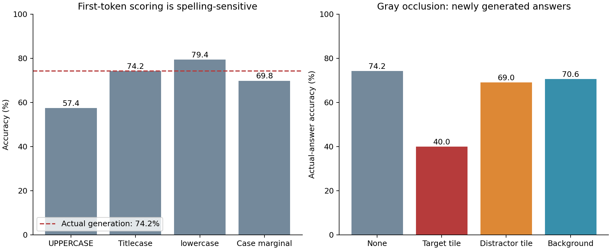
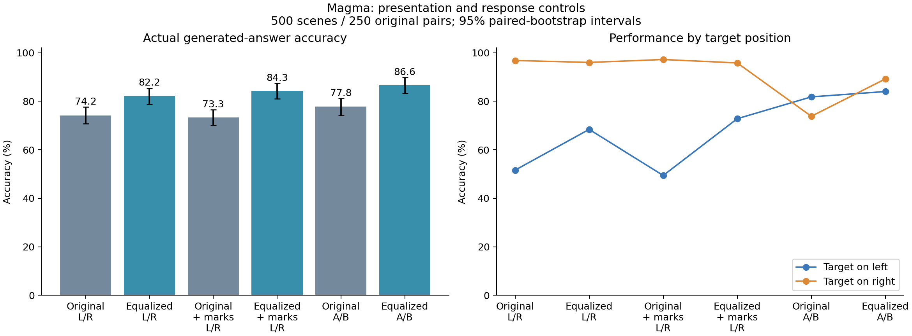

# Magma 후속 실험: 응답 점수와 화면·라벨 편향

실행일: 2026-10-14. 모델 재학습 없이 기존 10개 분야의 250개 이미지 쌍, 좌우 교환을 포함한 500개 장면에 대해 **6,500회 텍스트 응답 생성**을 완료했다. 6,500개의 독립 표본이 아니라 같은 쌍의 반복 측정이다. 로봇 행동 성공률을 평가한 실험은 아니다.

핵심 결과는 **기존 점수 계산의 표기 민감도와 화면/응답 방식의 영향을 모두 확인했다**는 것이다. 이를 semantic reasoning 능력의 소실이나 복원으로 단정할 수는 없다.

## 1. 응답 토큰 점수 수정 및 가림 실험

원본 장면의 실제 생성 정답률은 371/500 = **74.2%**이며, 이전 실험의 500개 원문 응답을 모두 재현했다.

| 첫 응답 토큰 비교 방법 | 정답률 | 실제 생성 선택과 일치율 |
|---|---:|---:|
| LEFT / RIGHT | 57.4% | 80.4% |
| Left / Right | 74.2% | 99.6% |
| left / right | 79.4% | 90.4% |
| 세 표기의 확률 합산 | 69.8% | 95.2% |

대문자 후보만 비교한 57.4%는 모델의 실제 답변 정답률이 아니다. Titlecase 점수가 실제 생성과 가장 가까웠지만, 이는 이번 관측 결과이며 이 데이터에서 가장 좋은 표기를 골라 일반 성능 개선으로 주장하면 안 된다. 소문자 점수의 79.4% 역시 생성 정답률이 아니다. 확률 합산은 여섯 토큰만 포함한 제한적 지표로, 모든 자연어 답변의 의미 확률이 아니다. 원본에서 여섯 토큰의 평균 확률 질량은 95.14%였다.

이번에는 가린 이미지마다 답을 실제로 다시 생성했다.

| 가린 영역 | 실제 생성 정답률 | 원본 대비 하락 | 원본 선택 변경률 |
|---|---:|---:|---:|
| 없음 | 74.2% | — | — |
| 정답 타일 | 40.0% | 34.2%p | 36.2% |
| 오답 타일 | 69.0% | 5.2%p | 18.0% |
| 배경 일부 | 70.6% | 3.6%p | 5.2% |

정답 타일 가림의 영향이 더 컸으므로, 모델이 정답 쪽 시각 정보에 의존한다는 증거다. 다만 원래 맞힌 371건 중 176건(47.4%)이 틀리게 바뀌었고, 가림 후 오른쪽 선택률은 88.8%였다. 정보가 사라졌을 때의 기본 선택 편향도 작용한다. 회색 타일 가림은 비자연적 입력이며, 배경 제어는 같은 픽셀 수의 흩어진 점이라 형태가 다르다. 따라서 객체 인식의 성공이나 attention의 인과성을 직접 증명하지 않는다.

## 2. 화면 균등화 및 LEFT/RIGHT–A/B 통제

원본의 오른쪽 타일 마스크 면적은 평균적으로 왼쪽의 **1.78배**였다. 관측 RGB에서 두 타일을 원근 보정해 같은 크기로 배치했다. 크기·원근·배경이 함께 바뀌므로 어느 하나만의 효과로 해석하지 않는다.

A/B 조건은 모든 장면에서 A-left/B-right와 B-left/A-right를 모두 실행했다. 같은 표시가 있는 이미지를 LEFT/RIGHT로 답하는 제어 조건도 추가하여 **동일한 이미지에서 응답 지시만 바꾸는 비교**를 확보했다.

| 조건 | 응답 수 | 정답률 | 정답 왼쪽 | 정답 오른쪽 | 오른쪽 선택률 |
|---|---:|---:|---:|---:|---:|
| 원본 + L/R | 500 | 74.2% | 51.6% | 96.8% | 72.6% |
| 균등화 + L/R | 500 | 82.2% | 68.4% | 96.0% | 63.8% |
| 원본 + 표시 + L/R | 1,000 | 73.3% | 49.4% | 97.2% | 73.9% |
| 균등화 + 표시 + L/R | 1,000 | 84.3% | 72.8% | 95.8% | 61.5% |
| 원본 + A/B | 1,000 | 77.8% | 81.8% | 73.8% | 46.0% |
| 균등화 + A/B | 1,000 | **86.6%** | **84.0%** | **89.2%** | **52.6%** |

주요 대응 비교의 95% 신뢰구간(원래 쌍 단위 bootstrap 2,000회, seed 20261014):

- 화면 균등화, L/R 유지: **+8.0%p [4.8, 11.4]**.
- 원본의 동일한 표시 이미지에서 L/R → A/B: **+4.5%p [1.8, 7.1]**.
- 균등화의 동일한 표시 이미지에서 L/R → A/B: **+2.3%p [0.6, 4.1]**.
- 원본 L/R → 균등화 A/B 전체 변경: **+12.4%p [9.1, 15.6]**.

좌우 교환 두 장면을 모두 맞히는 비율도 51.6% → 77.8%로 증가했다. A/B의 두 라벨 배치를 모두 실행했으므로 77.8%는 쌍×라벨배치 단위의 비율이다. 원본 A/B는 라벨 배치를 뒤집어도 물리적으로 같은 타일을 선택하는 비율이 74.0%에 그쳤고, 24.4%의 장면에서 두 배치 모두 B를 선택했다. 균등화 A/B의 물리적 선택 일관성은 92.0%, 항상 B 비율은 3.0%였다. **A/B로 바꾸는 것만으로 편향이 완전히 해결되지는 않는다.**

## 분야별 결과

아래 A/B 수치는 두 라벨 배치 평균이다. 분야별 표본 수가 다르므로 전체 micro 정답률과 분야별 macro 정답률을 구분한다. Macro는 원본 L/R 77.43%, 균등화 A/B 88.96%다. Counting/Symmetry의 이번 explicit-object 문항은 색상 단서 선택이므로 수 세기·대칭 추론 성능으로 해석하지 않는다.

| 분야 | 원본 장면 수 | 원본 L/R | 균등화 L/R | 원본 A/B | 균등화 A/B |
|---|---:|---:|---:|---:|---:|
| attribute | 40 | 60.0% | 87.5% | 61.3% | 88.8% |
| celebrity | 100 | 68.0% | 78.0% | 74.5% | 84.0% |
| counting | 20 | 100.0% | 100.0% | 100.0% | 100.0% |
| emotion | 20 | 65.0% | 95.0% | 95.0% | 97.5% |
| living_world | 100 | 91.0% | 90.0% | 94.5% | 99.0% |
| public_info | 20 | 75.0% | 85.0% | 85.0% | 82.5% |
| state | 60 | 58.3% | 70.0% | 57.5% | 68.3% |
| symmetry | 20 | 100.0% | 100.0% | 97.5% | 100.0% |
| time_clock | 20 | 90.0% | 70.0% | 97.5% | 90.0% |
| traffic | 100 | 67.0% | 76.0% | 66.0% | 79.5% |

## 해석 및 다음 연구

이번 결과는 기존 실패의 일부가 **화면 비대칭과 응답 형식에 민감한 선택 과정**에서 발생함을 뒷받침한다. 모델 내부의 reasoning이 파인튜닝으로 손상됐다는 가설은 이번 실험으로 검증하지 않았다. 원본 타일 픽셀을 유지한 전처리와 응답 지시 변경만으로 개선되었지만, 여전히 객체 식별 오류·라벨 대응 오류가 남을 수 있다.

다음에는 독립된 새 이미지 쌍에서 이번에 고정한 균등화+A/B 설정을 검증하고, 크기·원근·배경을 하나씩 바꾸는 요인 실험으로 효과를 분리하는 것이 좋다. 이후 동일한 표시 이미지에서 이름 말하기와 위치 선택을 비교하면 식별과 위치/라벨 대응 단계를 더 구체적으로 구분할 수 있다. 같은 데이터에서 최적 조건을 계속 고르는 것은 일반화 검증이 아니다.

## 재현·검증 및 파일

- Magma revision: `4159b1dedade8f88b5bbaaae7810299dee5228f5`. 학습 없이 bf16, eager, greedy 최대 8 토큰 생성. RTX 3090 두 장에 모델을 하나씩 올려 각 250장면을 처리했다.
- 모든 500장면 × 13개 기록 = 6,500개 고유 조건, 무효 응답 0개. 원본 원문 응답 500/500 일치, 이전 대문자 점수 최대 차이 `7.15e-7`.
- 10개 분야 pilot 130회에서 generate의 첫 토큰 점수와 별도 forward 점수를 검증했다. Pilot은 본 실험의 6,500회에 포함하지 않는다.
- 전체 조건의 native 입력 형상 `[1,2,3,512,512]` 동일. 표시된 L/R와 A/B 비교의 이미지 해시가 모두 동일함을 확인했다.
- 타일 마스크와 변환 사각형의 최소 IoU 0.9075. 원본 촬영의 가림·조명과 재표본화 효과는 남아 있다.
- 통계 단위는 250개 원래 쌍이며 좌우 교환과 라벨 배치를 함께 재표집했다. 범주별 분석과 다중 비교는 탐색적이며 신뢰구간은 다중 비교 보정하지 않았다. 다른 모델·데이터셋에 대한 일반화는 아직 검증하지 않았다.
- 추론 완료 직후 후처리 파일 준비 순서 때문에 자동 집계가 한 번 실패했다. 저장된 추론 결과를 그대로 사용해 집계와 그림 생성을 완료했으며, 추론을 다시 실행하거나 결과를 선택적으로 제외하지 않았다.

[사전 고정 프로토콜](../../docs/followup/PROTOCOL.md) · [실행 코드](../../scripts/followup/) · [재현 방법](../../docs/followup/REPRODUCE.md)

- `generations.csv`: 6,500개 응답, 정답, 조건, 라벨 배치, 가림 및 후보 점수. UTF-8 BOM이 있어 Excel로 열 수 있다.
- `raw_records.jsonl.gz`: 프롬프트, 토큰 ID, 원문 응답, 점수, 입력 메타데이터를 포함한 500개 원시 기록.
- `conditions.csv`, `categories.csv`, `paired_contrasts.csv`, `label_mappings.csv`, `scoring_occlusion.csv`: 집계와 대응 비교.
- `summary.json`, `verification.json`: 기계 판독용 결과 및 검증.
- `*_results.png/pdf`, `scoring_occlusion.png/pdf`: 공유용 그림.
- `provenance/`: 실행 환경, worker 완료 기록, 입력 manifest, 파일 SHA256.

서버 원시 결과는 `/root/Capstone/outputs/followup`, 처리된 이미지는 `/root/Capstone/outputs/followup_inputs`에 저장했다. 모델 가중치와 전체 이미지는 Git에 넣지 않았다. 이전 attention 결과는 그대로 보존했다. 이번 후속 실험에서는 새 attention map을 추출하지 않고 실제 응답과 토큰 점수로 기존 해석을 검증했다.
